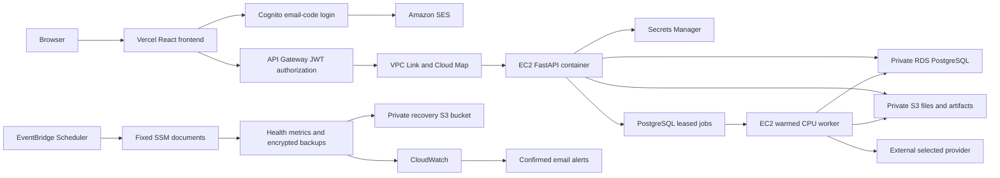

# Sentinel AWS architecture

The gateway validates the fixed Cognito issuer/client. FastAPI verifies the
identity token and checks the bound canonical account, email and live invite.
Approval stays only in page memory; same-account events update credentials
without remounting the workspace. Normal sign-in never links accounts solely
by matching a client-supplied email.

## Runtime and protection

- One always-running t3.small keeps the model warm. Separate nonroot/read-only
  API and worker containers each have one CPU allocated, with 512 MiB / 1,200 MiB
  memory limits. Durable state stays in RDS/S3, not the container filesystem.
- No public SSH or application ingress; only the VPC Link group reaches the
  private API port. RDS accepts traffic only from the application group, uses
  verified TLS, encryption and deletion protection. Administration uses SSM.
- IMDSv2 and instance roles replace embedded AWS keys. S3 public access is
  blocked. Five-minute upload tickets bind an exact object and size; the worker
  validates staged files. Downloads are short-lived signed URLs.
- PostgreSQL jobs have leases, bounded pending work and retry keys. A committed
  answer and its job result are linked atomically. Recovery is at least once;
  an external LLM call may repeat after interruption before its result commits.
- Provider keys use owner-specific Secrets Manager references. No plaintext
  provider keys enter browser bundles, source control or application backups.
- API/report/preview failures use the account/token-aware access gate. Ordinary
  resource denials do not revoke the workspace; outages preserve it.
- Seven-day logs omit tokens, keys, source documents and prompts. Five-minute
  checks cover worker/queue/backup age, failures, memory/disk, credits and Free
  plan status. The daily recovery job uses a separate private encrypted bucket.
- The scheduler can invoke only its fixed SSM documents on the dedicated host.
  Bootstrap-secret reads and image-push grants are temporary operator access.

## Measured capacity

These are controlled synthetic observations from the owner's computer to Sydney,
not a production SLA or broad load-test result.

| Measurement | Result |
|---|---|
| Three detector runs, 2,400 rows each | 1,520 / 1,788 / 2,402 ms inside the scan timer |
| Queued scan completion wait with polling/network | About 4.4 / 6.3 / 6.3 seconds |
| Parallel case-list reads | About 0.4–0.5 seconds after a ~2.1-second initial request |
| 2,400-row index preparation | About 57.8 seconds, in the background |
| Small case preparation | About 4.8 seconds total |
| Large PDF report | 2,431,153 bytes downloaded successfully |
| Four-scan history | 12,254,094 decoded JSON bytes loaded with HTTP compression |

The warmed worker initially used about 473 MiB. A large report retained about
1 GiB before a memory-release improvement. After that change and another large
scan, the worker returned to about 492 MiB and the host had about 845 MiB
available. A 1 GiB host is not supported. Sustained heavy processing or more
simultaneous jobs needs a new capacity check and possibly a larger permitted host.

Native Chrome inspected actual AWS request paths: tab returns and token refresh
caused no extra `/me` calls; reload required a new check. A separate controlled-
service Chrome test covers active operations, temporary outages and revocation.

## Cost boundary

AWS Price List API rates checked October 25, 2026, Sydney, 730 hours/month:

| Provisioned item | Rate | Approximate monthly amount |
|---|---|---|
| t3.small Linux | $0.0264/hour | $19.27 |
| db.t4g.micro PostgreSQL Single-AZ | $0.025/hour | $18.25 |
| 20 GiB EC2 gp3 | $0.096/GB-month | $1.92 |
| 20 GiB RDS gp2 | $0.138/GB-month | $2.76 |
| One public IPv4 for outbound connectivity | $0.005/hour | $3.65 |
| Subtotal | | $45.85 |

Secrets, images, S3, monitoring, mail, requests and transfer add to this. Use
$50–60/month as a planning allowance before credits, free benefits and taxes,
not a guaranteed bill. External LLM usage is separate. Pricing responses are in
protected evidence. References: [EC2](https://aws.amazon.com/ec2/pricing/on-demand/),
[RDS](https://aws.amazon.com/rds/postgresql/pricing/),
[IPv4](https://aws.amazon.com/vpc/pricing/).

The account remains Free. Spending alerts are $10/$30/$60/$80 monthly, plus a
remaining-credit alarm below $20. Alerts do not stop spending. Do not upgrade
automatically or describe the always-running stack as permanently free.
